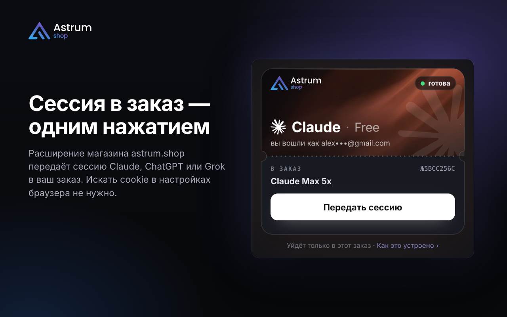
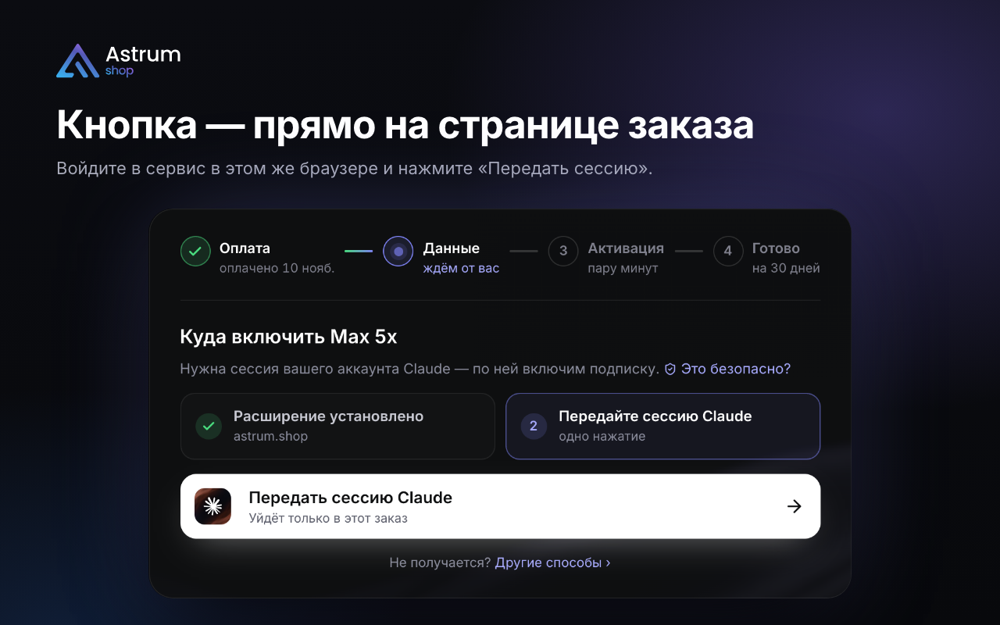
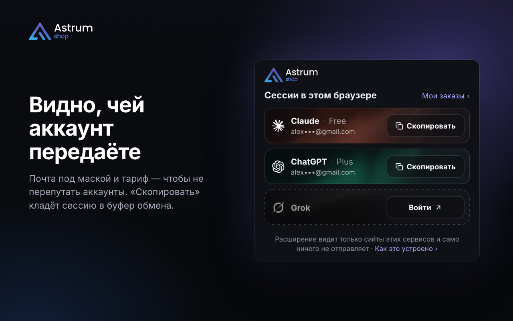

# Расширение astrum.shop

Передаёт сессию Claude, ChatGPT или Grok в ваш заказ на [astrum.shop](https://astrum.shop) — одним нажатием, без
поиска cookie в настройках браузера.

[In English](#in-english) · [Что расширение видит](PRIVACY.md) · [Лицензия MIT](LICENSE)

## Зачем

[astrum.shop](https://astrum.shop) — подписки на ChatGPT, Claude и Grok с активацией на вашем аккаунте; оплата картой,
СБП или USDT. Чтобы включить оплаченную подписку, магазину нужна **сессия** — уже выполненный вход в сервис. Пароль
не нужен, и расширение его не видит.

Без расширения сессию достают руками: инструменты разработчика, список cookie, скопировать, вставить. С расширением —
одна кнопка на странице заказа.

## Как это работает

1. Откройте свой заказ на astrum.shop.
2. Войдите в Claude, ChatGPT или Grok в этом же браузере — если ещё не вошли.
3. Нажмите «Передать сессию» — на странице заказа или в окне расширения.
4. Нажмите «Включить» на странице заказа.

Без открытого заказа окно показывает, в какие сервисы вы вошли в этом браузере, под какой почтой и на каком тарифе.
«Скопировать» кладёт сессию в буфер обмена.

## Что расширение делает с данными

- Сессия уходит **только по вашему нажатию** и только на страницу вашего заказа на astrum.shop. Сайт сам запросить её
  не может.
- Расширение **ничего не хранит** и ничего не отправляет другим сайтам. Своего сервера у него нет.
- Оно работает только на `claude.ai`, `chatgpt.com`, `grok.com` и `astrum.shop`. Другие сайты, историю браузера и
  пароли не видит.
- В нём нет рекламы, счётчиков и кода, который загружается из сети.

По пунктам — в [PRIVACY.md](PRIVACY.md).

## Доступы

| Доступ | Зачем |
| --- | --- |
| `cookies` | узнать, вошли ли вы в сервис, и прочитать сессию Claude и Grok |
| сайты `claude.ai`, `chatgpt.com`, `grok.com` | узнать почту и тариф аккаунта и прочитать сессию ChatGPT |
| сайт `astrum.shop` и `scripting` | связать расширение со страницей вашего заказа, в том числе во вкладке, открытой до установки |

## Проверьте сами

Весь код — в папке [`src/`](src): обычные скрипты без зависимостей и без сборщика, около полутора тысяч строк. В
магазин расширений попадают эти же файлы как есть.

- Правила «кому и когда можно отдать сессию» — в одном файле, [`src/protocol.js`](src/protocol.js).
- Какие сервисы и что у них читается — [`src/services.js`](src/services.js).
- Тесты — `node --test tests/`: меньше секунды, браузер не нужен.
- Собрать самому и сравнить с установленным из магазина — `node pack.mjs chrome`, результат в `dist/chrome`.

## Установка

- **Из магазина Chrome** — ссылка появится здесь после проверки магазином.
- **Из исходников:** `node pack.mjs chrome`, затем откройте `chrome://extensions`, включите «Режим разработчика» и
  нажмите «Загрузить распакованное» → папка `dist/chrome`. Проверено в Chrome; в других браузерах на Chromium должно
  работать так же.

## Сборки

| Команда | Что получится |
| --- | --- |
| `node pack.mjs chrome` | папка `dist/chrome` — её можно подключить как распакованное расширение |
| `node pack.mjs chrome --zip` | архив для Chrome Web Store; сначала прогоняются тесты, красные архив не дадут |
| `node pack.mjs firefox --zip` | архив для каталога Firefox |
| `node pack.mjs chrome --copy-only --zip` | версия без передачи в заказ: только «Скопировать» в буфер обмена |
| `node pack.mjs chrome --dev` | сборка для разработки: работает и с локальным сайтом на `localhost:3000` |

Нужен только Node.js 20 или новее. Номер версии — поле `version` в обоих `manifest.*.json`.

## Что где

| Файл | Что делает |
| --- | --- |
| `src/protocol.js` | общий язык со страницей заказа и правила «кому и когда можно отдать сессию» |
| `src/services.js` | таблица сервисов: где лежит сессия, куда вести «Войти», знак и цвета |
| `src/reader.js` | читает сессию, почту и тариф аккаунта у сервиса; ничего не хранит |
| `src/router.js` | разбирает сообщения фону: кто спрашивает и что ему ответить |
| `src/background.js` | фон: подключает всё это к браузеру |
| `src/content.js` | скрипт на страницах astrum.shop: мост между страницей заказа и фоном |
| `src/popup.*` | окно расширения |
| `tests/` | тесты на встроенном `node:test`, без зависимостей |
| `pack.mjs` | сборка |
| `store/` | карточка в магазине расширений: тексты и снимки |
| `art/` | значки расширения из знака Astrum |

## Лицензия

Код — под [лицензией MIT](LICENSE). Название и логотип astrum.shop лицензией не передаются. Шрифт Inter — под
лицензией SIL Open Font License ([`src/fonts/OFL.txt`](src/fonts/OFL.txt)).

Claude, ChatGPT и Grok — товарные знаки их владельцев. Расширение — часть магазина astrum.shop; оно не является
продуктом Anthropic, OpenAI или xAI и не связано с ними.

## In English

The astrum.shop extension lets a customer of the [astrum.shop](https://astrum.shop) store pass the sign-in session of
their own Claude, ChatGPT or Grok account into their own order with one click, so the store can activate the
subscription they paid for on that account.

- The session is passed **only when you click**, and only to your order page on astrum.shop. The site cannot request it.
- The extension **stores nothing** and sends nothing to any other site. It has no server of its own.
- It works only on `claude.ai`, `chatgpt.com`, `grok.com` and `astrum.shop`.
- No ads, no analytics, no remote code.

Details: [PRIVACY.md](PRIVACY.md#english-version). The code in [`src/`](src) is plain scripts with no dependencies and
no bundler — the same files go to the extension store. Run the tests with `node --test tests/`.

Licensed under [MIT](LICENSE). Claude, ChatGPT and Grok are trademarks of their respective owners; this extension is
not affiliated with Anthropic, OpenAI or xAI.
